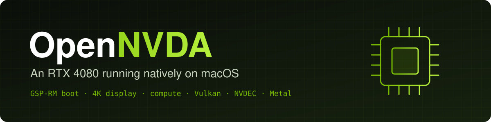
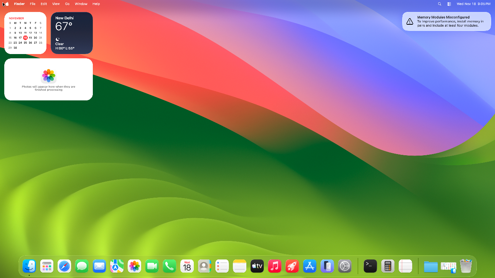
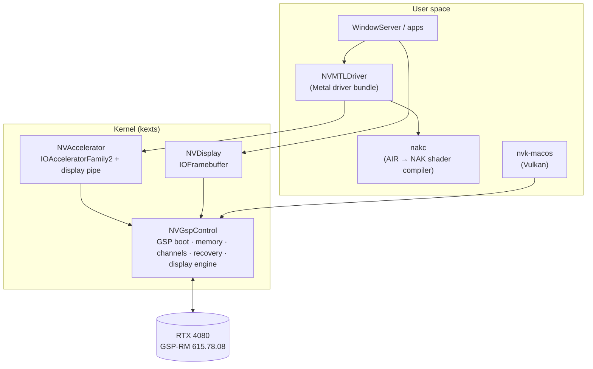

<div align="center">



<br>


-76B900?logo=nvidia&logoColor=white)


[](https://github.com/bdwithganesh/OpenNVDA/stargazers)

**An RTX 4080 driving macOS Tahoe through its own GSP firmware: a Metal desktop at 4K60, Liquid Glass and all, plus a long list of things that still don't work.**
<br>
Not a framebuffer hack. Not a translation layer. macOS talks to the real card.

[What works](#-what-works-today) · [Numbers](#-the-numbers) · [What changed](#-since-2-october) · [How it fits together](#-how-it-fits-together) · [Build](#-building) · [Support](#-want-this-to-become-a-real-driver) · [Credits](#-credits)

<a href="https://www.buymeacoffee.com/bdwithganesh"></a>

</div>

> [!NOTE]
> **Made for fun**, on one PC, by one person and an unreasonable number of reboots. It isn't a product. Please don't put it on a machine you need tomorrow morning. If you'd like it to grow into a real driver, [here's how you can help](#-want-this-to-become-a-real-driver).

## 🤔 Why this exists

Apple stopped shipping drivers for NVIDIA cards after Kepler. From Mojave on, nothing. A modern RTX card in a Hackintosh just sits there, or at best shows the firmware's boot screen and never gets touched again.

I wanted to know how far one person could get. Further than I expected, honestly.

## ✅ What works today

This is the **19 November 2026** checkpoint. It's a snapshot, not a release.

| | |
|---|---|
| **GPU** | NVIDIA GeForce RTX 4080 16 GB (AD103, Ada) |
| **Host PC** | MSI X870E GAMING PLUS WIFI, Ryzen 9 7950X |
| **macOS** | Tahoe 26.7.3, as a Hyper-V guest on Windows 11, with the RTX handed over whole (DDA) |
| **Firmware** | NVIDIA GSP-RM 615.78.08 (you bring your own copy) |
| **Display** | BenQ PD2705U on the card's DisplayPort, 3840×2160 at 60 Hz |
| **Installed stack** | NVGspControl 0.180.187 · NVAccelerator 0.5.37 · NVDisplay 1.4.1 · NVMTLDriver 0.9.86 |
| **This repo** | Same source the installed binaries were built from ([how that was checked](docs/evidence/2026-11-19/README.md#source-matches-whats-installed)) |

About that VM: since October the work happens inside a Hyper-V guest, because rebooting a VM is a lot faster than rebooting a whole PC. The GPU isn't emulated or shared. The guest gets the entire card, boots its GSP firmware and programs the display engine itself. The VM just supplies CPU, RAM and disks. The 2 October numbers were bare metal. This checkpoint hasn't been rerun on bare metal yet.

#### 🟢 Checked on the machine

- **System Information says "Metal Support: Metal 4".** The card shows up as an RTX 4080 with 16 GB, and the display runs at 4K 60 Hz.
- **The whole desktop is composited on our Metal driver at 60 fps,** with the GPU at about 4 % busy and 5.9 ms flip latency. That includes Liquid Glass: Dock, widgets and menus blur properly. The check reads the blurred pixels back out of the scan-out buffer instead of trusting a screenshot.
- **Colour goes through the hardware.** CoreDisplay's gamma lands in the display head's output LUT, so no shader pass is spent on colour. Scan-out is double-buffered, and flips latch at vblank, so no tearing.
- **Our Metal contract tests:**
  - Metal 3 set: 9/9.
  - Metal 4 set: 16/16.
  - Broader suite: 83 of 84. The one failure is a legacy-path test that doesn't apply to this runtime.
  - Mesh shaders, MetalFX spatial upscaling, MPS / MPSGraph matrix multiply and Core Image blur all pass.
  - These are our tests, not Apple's conformance suite.
- **A hung or faulting GPU job no longer takes the desktop down.** The bad command buffer ends with `MTLCommandBufferErrorTimeout`, and the same process keeps going on a rebuilt channel. Tested with deliberate hangs and page faults: 0 problems.

#### 🟡 Works, with an asterisk

- **The desktop freezes for about 5 s while a hang is being detected.** Compute preemption is CTA-level only; turning on CILP made it worse (~9 s).
- **Scan-out still involves a CPU copy.** WindowServer's frame is memcpy'd into a system memory aperture, then the copy engine moves it into VRAM. That costs ~18 % of one core while things animate. The plan is copy-engine-only, straight from the IOSurface.
- **Mission Control and window drags** are mostly smooth now (0 frames over 34 ms across three open/close cycles). Some apps still hitch on their own timers.

#### 🔴 Not there yet

- **FP32 through Metal is ~21 TFLOPS,** less than half of what the raw runtime managed with its hand-tuned kernels. I don't know why yet. Boost requests do reach the firmware, and the GPU reports P0. That leaves the clocks we actually get, or how the shader compiler handles this kernel. It's next on the list. Details in [the numbers](#-the-numbers).
- **Metal blits between VRAM buffers are slow** (~45 GB/s). A compute copy does ~298 GB/s on the same buffers.
- **Missing pieces:**
  - ray tracing
  - argument buffers tier 2
  - more than one display mode
  - hardware video decode in VideoToolbox
  - HDMI/DP audio
  - hardware cursor
  - sleep/wake
- **Not proven:** long-session and all-day stability, and app coverage beyond what we test. Geekbench 7 hasn't been rerun since October; back then its Metal Background Blur aborted on an unsupported AIR load.

### What it looks like

[](docs/evidence/2026-11-19/desktop-scanout-720p.png)

That's the 4K frame read straight out of the scan-out buffer in VRAM (18 Nov, 21:06 IST), shrunk to 720p for the README. Widgets, the Dock divider and the glass are all rendered by the RTX through NVMTLDriver. The "Memory Modules Misconfigured" warning comes from the Mac Pro SMBIOS the guest uses, not from the driver. The 2 October [Safari](docs/evidence/2026-10-02/safari-on-tahoe.png) and [desktop](docs/evidence/2026-10-02/desktop-after-lut.png) captures are still there for comparison.

## 📊 The numbers

<div align="center">

</div>

<br>

| Test | Linux (NVIDIA 570) | Windows (NVIDIA) | macOS, raw `nvrun` (Sept) | **macOS through Metal (19 Nov)** |
|---|---:|---:|---:|---:|
| GPU memory fill | 663 GB/s | 649 GB/s | 668.5 GB/s | **621-626 GB/s** |
| GPU copy kernel | 293 GB/s | 290 GB/s | 309.0 GB/s | **297-299 GB/s** |
| FP32 compute | 47.27 TFLOPS | 47.38 TFLOPS | 47.72 TFLOPS | **20.5-21.0 TFLOPS** |
| Host → GPU / GPU → host | 26.9 / 26.4 GB/s | 26.8 / 26.4 GB/s | 26 GB/s | **21.4 / 22.5 GB/s** |
| Metal blit, VRAM → VRAM | n/a | n/a | n/a | **44-49 GB/s** |

**How to read this.**

- The first three columns are from September: the same PC and card, booted straight into each OS, warmed up. macOS used our own low-level runtime there (`nvrun` + NAK shaders), not Metal.
- The last column is new. It's an ordinary Metal program ([`tools/bench/mtlbench.m`](tools/bench/mtlbench.m)): 256 MiB buffers, GPU timestamps, best of five after a warm-up. It ran inside the VM.
- Memory bandwidth through Metal is basically where the raw numbers were.
- FP32 isn't, and the cause isn't pinned down yet. Two suspects: the clock the shader core actually runs at, and the code our compiler emits for this kernel. The September number came from hand-written kernels. Finding out which is the next job.
- Host↔GPU goes through the hypervisor's IOMMU now, which probably costs a bit.

Raw output: [mtlbench.txt](docs/evidence/2026-11-19/mtlbench.txt).

## 🔧 Since 2 October

The short version: in October the desktop technically ran on our Metal driver at a couple of frames a second. Now it's smooth. Most of the work went into finding out *why* it was slow, one measurement at a time.

- **Moved to GSP-RM 615.78.08 with our own runtime on top of it.** Memory management, page tables, channels and recovery are handled by us; RM is asked only for what it has to do.
- **2 → 45 fps:** the display pipe wasn't getting vblank callbacks.
- **11 → 55 fps:** GPU page tables marked every system-memory page as volatile, so the GPU's L2 never cached any shared buffer or IOSurface. One 4K pass dropped from 62 ms to 1.7 ms.
- **55 → 60 fps, and GPU load from ~65 % to ~5 %:** CoreDisplay was running a full-screen colour shader every frame, because we didn't advertise a hardware colour pipe. Now gamma goes into the output LUT.
- **Liquid Glass seams:** 1 px lines along glass edges. NVIDIA helper lanes read 0 from global memory. When a shader branched on a loaded value right before `fwidth`, the derivative came out wrong. The compiler now patches those loads (top-level branches only; doing it inside loops hung the GPU at boot, so that version was pulled).
- **App icons borrowing each other's pixels:** render pass descriptors weren't copied at encode time.
- **A shader cache race:** two processes compiling the same shader could tear the cache file.
- **Window dragging:** every frame mapped and unmapped the same IOSurfaces, 816 ms of a 6 s drag. Now 103 ms.
- **Mission Control:** mapping a new 4K surface took 34 ms of page table read-backs. Now 2.8 ms.
- **Per-process recovery** from GPU hangs and page faults.

## 🧩 How it fits together



<details>
<summary><b>What's in each folder</b></summary>

<br>

| Folder | What it is |
|---|---|
| `drivers/NVGspControl` | The main kext. Boots GSP, runs the native 615 runtime (MMU, channels, faults, recovery), drives the display engine |
| `drivers/NVGspCore` | Header-only core shared by the kexts and the host tests: ABI structs, page tables, fault decoding, recovery rules |
| `drivers/NVDisplay` | IOFramebuffer on top of NVGspControl, the thing WindowServer talks to |
| `drivers/NVAccelerator` | IOAcceleratorFamily2 accelerator and display pipe, the kernel half of Metal |
| `drivers/NVMTLDriver` | Metal driver bundle, the user half of Metal |
| `tools/nakc` | The shader compiler: Apple AIR in, NIR in the middle, Mesa's NAK out |
| `tools/bench` | `mtlbench.m`, the Metal benchmark behind the numbers above |
| `drivers/nvdec`, `drivers/nvenc` | H.264 / HEVC decode on NVDEC, early NVENC encode |
| `drivers/NVVTDecoder` | VideoToolbox decoder plug-in (parked) |
| `drivers/nvk-macos` | Mesa's NVK Vulkan driver, ported to run on our kext |
| `drivers/NVMSIProbe` | A tiny probe for MSI interrupt routing (real vblank interrupts are still on the list) |
| `drivers/NVFramebuffer`, `drivers/NVFBProbe` | Where it all started: the GOP framebuffer kext and the first hardware survey. Kept as fallbacks |
| `research/full-metal-rnd` | Notes from the road to full Metal |
| `tools/gen_booter_unload.py` | Builds the one NVIDIA firmware header the kext needs, from your own linux-firmware copy |

</details>

## 🛠 Building

You need MacKernelSDK. Then, from the repo root:

```sh
python3 tools/gen_booter_unload.py /path/to/linux-firmware/nvidia/ad103/gsp/booter_unload-570.144.bin
# The GSP image (gsp_ga10x.bin) and ucodes come from NVIDIA's 615.78.08 Linux driver package;
# pack them with tools/nvgsp_package.py (see --help).
sh tools/build_kext.sh NVGspControl /path/to/MacKernelSDK [gsp-package.bin]
sh tools/build_kext.sh NVDisplay    /path/to/MacKernelSDK
sh tools/build_kext.sh NVAccelerator /path/to/MacKernelSDK
```

The Metal bundle and the compiler build on the Mac itself: `sh drivers/NVMTLDriver/build.sh`, and `tools/nakc/build_target.sh` against a Mesa 26.0.8 tree with the patches in `tools/nakc`.

> [!CAUTION]
> **There's no NVIDIA firmware in this repo, and there never will be.** GSP-RM, the booters and the VBIOS belong to NVIDIA. Take them from linux-firmware or your own driver install; `nvgsp_package.py` packs them for the kext.

`sh tests/run_host_checks.sh` runs the hardware-free checks: real driver and core code against mocks and recorded GSP replies. Nothing gets loaded. At this checkpoint: 47 pass, 8 skipped (they need firmware files or captures you'd have to supply), 0 fail. Other tests live next to their parts: `drivers/nvdec/tests/*/run.sh`, `tests/nvkmd_macos/run.sh`.

## ⚠️ Before you try it

- It's written for **one** card (AD103). Other Ada cards might get somewhere. Older ones won't.
- You need:
  - an OpenCore setup;
  - SIP and authenticated root off;
  - either a VM with whole-device passthrough or a second OS to fall back to when a test goes wrong.
- A bad GPU state can still need a cold reboot. Back up your stuff. I'm not responsible for what happens to your machine.
- Not affiliated with NVIDIA or Apple. Trademarks belong to their owners.

## 🗺 Roadmap

- [x] GSP-RM boot, display, ReBAR, write-combining, power states
- [x] Compute, copy engines, Vulkan (NVK), NVDEC
- [x] Metal basics, WindowServer on our GPU
- [x] macOS Tahoe 26 bring-up
- [x] Smooth 4K60 desktop on the native Metal path, Liquid Glass included
- [x] Gamma through the hardware output LUT, tear-free double-buffered flips
- [x] Per-process recovery from GPU hangs and page faults
- [ ] FP32 through Metal back near the raw ~47 TFLOPS
- [ ] Scan-out without the CPU copy
- [ ] Fast Metal blits, ray tracing, argument buffers tier 2
- [ ] Display modes beyond 4K60, real MSI vblank interrupts
- [ ] Hardware cursor, sleep/wake, HDMI/DP audio, VideoToolbox decode
- [ ] Long-session qualification, and a bare-metal rerun
- [ ] PyTorch (MPS), then MLX, on the RTX

## ☕ Want this to become a real driver?

Right now it's a hobby: nights and weekends on one PC. To turn it into something other people can install and trust, it needs:

- **time** (months, not weeks);
- **more cards to test on**: a 4070 or 4090, a 30-series;
- **a spare machine**, so one broken boot doesn't stop everything.

<div align="center">

<a href="https://www.buymeacoffee.com/bdwithganesh"></a>

</div>

Backers get their name in this README. If a company or a group wants to fund proper work (more cards, a stable release), open an issue titled **"Funding"** and let's talk.

Even a ⭐ or a share helps. It tells me people actually want this.

## 🙏 Credits

**Built by [bdwithganesh](https://github.com/bdwithganesh).**

To be upfront: a lot of the code was written with AI help. The rest was me:
- the idea, and the stubbornness to keep going;
- every direction call;
- the hardware and every test on it: hundreds of reboots, reference captures, reading logs at 3 am;
- deciding what "working" actually means.

This stands on other people's shoulders:

| Project | What I owe them |
|---|---|
| **nouveau** | Years of reverse engineering NVIDIA GPUs |
| **NVIDIA open-gpu-kernel-modules / open-gpu-doc** | Without these, GSP-RM would be a black box |
| **Mesa (NVK, NAK)** | The Vulkan driver and the shader compiler this builds on |
| **envytools** | Register documentation |
| **acidanthera** | MacKernelSDK, Lilu, OpenCore |
| **WebKit** | The VideoToolbox SPI declarations |

Where the code follows one of them closely, the comment right there says so. Full list with licences: [THIRD_PARTY_NOTICES.md](THIRD_PARTY_NOTICES.md).

## 📄 Licence

MIT, see [LICENSE](LICENSE). Third-party files keep their own headers and licences.

<div align="center">
<sub>Made in India 🇮🇳, one reboot at a time.</sub>
</div>
